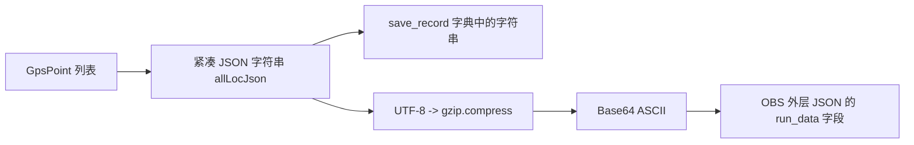

# GPS 数据结构、序列化与 Android 分析

## Python 实际实现

- `running/models.py::GpsPoint`：`lat/lon` 为 float 角度，`time` 为 Unix 毫秒 int；`speed` 默认 2.5（米/秒），`accuracy` 默认 3.0，`isValid` 默认 True；`to_dict` 原样输出这六个字段。
- `FivePoint` 为独立必经点模型，保留部分 raw 元数据。`GeoPoint` 的经度内部名为 lng，GPS 模型为 lon；policy 还区分原始坐标与显式 GCJ 锚点，不能把命名差异当作坐标转换。
- `execute_full_run` 用 profile 返回时间为 stopTime，`startTime=stopTime-totalTime*1000`；不是手机实际 GPS 采集。profile 查询失败存在本机时间回退。
- `consistency.distance` 用 Haversine、地球半径 6371000 米。`sample_route` 按累计距离采样，保留拐点，常规间隔 3000 ms；段内球面插值，处理零长/重合/近对跖情况，超过 100000 段拒绝。
- GPS 点速度：相邻两点球面距离 ×1000÷毫秒差，第一点取总距离÷总秒数；单位米/秒。builder 的结算 `speed_val=round(distance/seconds*1000)` 与该单位不同，不能直接作为每公里配速。Android 配速明确使用 `秒数×1000/米数`，显示分/公里。
- `validate_totals` 检查正整数秒、非负整数步数、起止毫秒差与总时长、有限正距离。`check_track` 检查点数、起止、坐标、时间递增、速度有限且非负、距离误差 `max(0.1m,目标×0.0001)` 和必经点覆盖。
- `time_buckets` 每 10 秒分桶，最后一桶可不足 10 秒；用整数分配总步数和厘米距离，避免尾桶丢失。

## Python 编码层次



分桶、固定点等也分别编码，不是把整个 OBS JSON 压成一个 gzip。反向分析为 Base64 解码 → gzip 解压 → UTF-8 → JSON；原 builder 提供编码辅助函数，没有统一的运行时反解 API，原测试自行反解检查。Android 不构造/上传平台 OBS 载荷，也不导入未解压的 OBS 包；只支持下列本地轨迹格式。

## Android 模型与分析页面

`TrackPoint(latitude,longitude,elapsedSeconds,elapsedMillis?)`：相对时间以毫秒精度保留，默认整秒，`millis` 为一致的实际相对时间。`SportRecord.startedAt + millis` 得到绝对毫秒。记录总时长当前要求完整秒，亚秒轨迹点不丢弃；非整秒总时长会明确拒绝。

「GPS 轨迹分析」可选择本地轨迹，查看点数、距离、时长、平均配速、前三点 JSON 和前十点数据、结构校验结果；原「记录」详情保留示意图和完整轨迹导出。模拟样本显示「模拟轨迹·仅本地（测试数据）」。

支持三种 JSON：

1. 应用记录文件：`{"schemaVersion":1,"records":[...]}`，可完整备份记录与轨迹。
2. 相对轨迹：`{"title":"测试轨迹","startedAt":0,"points":[{"latitude":0,"longitude":0,"elapsedSeconds":0},{"latitude":0,"longitude":0.001,"elapsedSeconds":2}]}`。
3. Python 解码后的 GPS 数组：`[{"lat":0,"lon":0,"time":1700000000000},{"lat":0,"lon":0.001,"time":1700000002000}]`；speed/accuracy/isValid 等辅助字段不作为运动真实性或成功证据。

支持应用原有十列表头 CSV，以及以下纯轨迹 CSV：

```csv
lat,lon,time
0,0,1700000000000
0,0.001,1700000002000
```

或相对时间版 `latitude,longitude,elapsedSeconds`，最后一列可为 `0.5` 等精确到毫秒的小数。应用十列 CSV 的 elapsedSeconds 同样可导出、导入毫秒小数。

除带有既有模拟标签的应用文件外，外部轨迹统一为「导入·未认证」；不能导入成已认证真实成绩。导入限制仍为 8 MiB、每条 5000 点、最多 500 条/50000 点，整批失败不部分写入。经纬度有限数、范围、单调时间、起止时长及实际轨迹距离均验证。不能接受 NaN、逆序时间、缺列或时间精度不一致。

「导出本地测试结果」输出独立 `TestReport(testOnly=true,tasks,localChecks)`，与轨迹备份文件不同，不当作轨迹重新导入。
