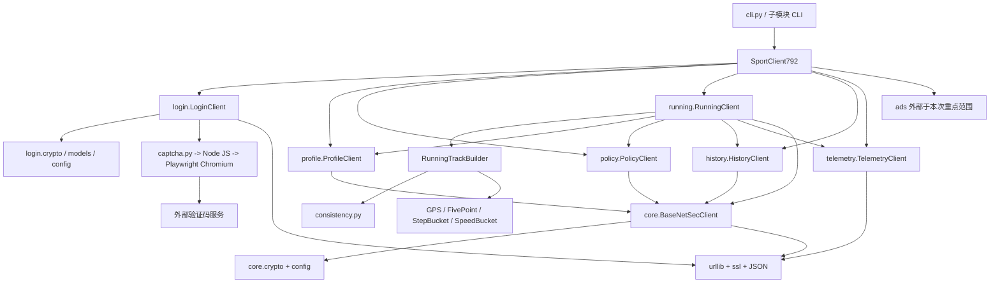
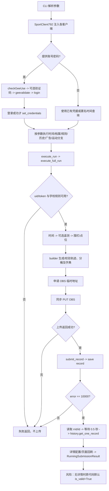

# 原 Python 协议项目源码分析（7.3.92 优先）

本报告依据实际读取的 Python 源码及 AST 索引，不以 README 代替实现。分析覆盖指定九个模块、38 个 Python 文件。没有执行真实登录、OBS 上传、运动结算或真实成绩查询，也没有使用校园跑账号。原文件未修改。

完整到函数级的参数、默认值是否存在、返回类型/表达式、调用和异常索引见[源码接口索引](源码接口索引.md)，全部内部文件导入边见[文件依赖图](文件依赖图.md)。索引脚本为 `android/scripts/analyze-python.py`，仅解析 AST，不 import 协议模块。静态调用图不能证明远端业务行为，也不能穷尽动态分派。

## 模块职责、输入输出与异常

| 模块 / 实际入口 | 主要类和方法 | 输入 → 输出 | 调用与异常边界 |
| --- | --- | --- | --- |
| `core/client.py` | `BaseNetSecClient`；`set_credentials`、`build_headers`、`execute_request` | uid/token/unid、设备配置；method/url/body/custom headers/sign params/timeout → 请求头和响应密钥、解密后的任意 JSON/文本或错误字典 | `build_headers` 生成毫秒时间、nonce、tokenSign/headerSign；POST 单独加密请求体。`execute_request` 默认 20 秒，HTTPError 优先解析错误 JSON，其他异常返回 error=-1。头部/请求构造在 try 外，密码学/参数异常可直接传播。HTTP 错误和业务错误没有统一的独立字段。 |
| `core/crypto.py`、`config.py` | `NetSecClient.encrypt_request/decrypt_response`，AES-CBC、RSA 封装、响应 KDF、`compute_token_sign`、`load_customer_device` | Python 对象/字节、密钥、签名参数 → 加密封装、响应密钥、明文或摘要；本地可选设备文件 → 设备字典 | 标准库实现，没有 Android Native SO；不是 Kotlin 可直接链接模块。加密/解密函数有长度、数据、解码异常，调用者需处理。本 Android 不复制平台密钥、盐或请求签名。 |
| `login/client.py` | 独立 `LoginClient`；`login`、`check_gee_use`、`gee_validate`、`submit_login` | username/password、会话 UUID、进度回调 → `LoginResult(success,error_code,message,user,raw)` | 登录初审仅当 data is True 时跳过验证码，否则最多三次二次校验；正式登录 error=10000 且有 data 才构造 `UserProfile`。网络响应转错误字典，但求解器异常可传播。成功模型含敏感 token，不应直接记录 raw。 |
| `login/captcha.py`、models/crypto | `GeetestV4Solver.solve`，`GeetestResult.to_validate_payload`，登录专用 crypto 副本 | captcha_id、Node 路径、JS 路径、默认 60 秒 → 解析 `FINAL_RESULT:` 的验证码结果 | 子进程调用 Node/Playwright/Chromium 及外部验证码资源；缺少程序/文件抛 FileNotFoundError，超时抛 TimeoutExpired，没有结果抛 RuntimeError。Python 标准库核心不等于完整登录免浏览器。Android 不移植此流程。 |
| `profile/client.py`、models | `ProfileClient` 继承 core；`get_server_time/get_user_info/get_home_base_user_info/get_home_extended_info`；五个首页读取及 `warmup_dashboard_session` | 可选目标 uid、现有凭据 → `ServerTime`、资料模型、聚合字典或 None | `ServerTime.from_api` 计算 `(server-local)/1000`；失败时 `get_server_time` 返回本机时间模型，不能据此证明远端同步成功。模型转换的 int/float、结构错误可能传播；基础/扩展资料缺 UID 返回 None。 |
| `policy/client.py`、models | `PolicyClient`；规则/围栏/学期/目标；`get_distance_route_points/get_checkpoints_for_run/get_run_checkpoints`；`RunRule/GeoPoint/GeoFenceArea` | mode、学校、距离、锚点、区域、UUID → 规则、围栏、学期、`GeoPoint` 列表或 None/[] | 路线点只允许指定计分模式，要求正整数距离和有效鉴权/学校/区域。选区不明确、围栏不匹配、无 GCJ 锚点、响应 pointsResModels 缺失/空/格式坏时记录 `last_checkpoint_error` 并返回 []。通用读取的模型转换异常仍可能传播。 |
| `telemetry/client.py` | 独立 `TelemetryClient`；启动/页面/设备埋点、`check_control_message`、四个委托读取函数 | uid/unid、items、设备信息、netsec_client → 状态/业务字典 | `_post_json` 默认 10 秒、控制消息 5 秒，异常统归 error=-1；不继承 core，其他查询要求参数实现 execute_request。原门面给它传自身，但门面没有该方法，存在静态能力不匹配。Android 不集成任何埋点或广告。 |
| `running/` | `RunningClient.execute_full_run`；`RunningTrackBuilder.generate_track_around_points/build_submission_payload`；GPS/分桶/提交结果数据类 | 目标距离、时长、类型、规则/围栏/凭据 → GPS/FivePoint、结算字典、OBS 字典及对象 key，最终 `RunningSubmissionResult` | builder 使用 `consistency.py` 在网络前做几何/时间/分桶校验，非法输入 TypeError/ValueError 停止。client 组合 profile/policy/history/telemetry，按顺序同步执行；没有持久化状态机。详见另外三份专项说明。 |
| `history/client.py`、models | `HistoryClient.get_one_record/get_run_records/get_indoor_records/get_calendar_list/get_history_config/get_data_index`；`RunRecordDetail`、`parse_history_records/history_record_status` | rrid；页码/页长/sid/type；年月 → 详情 Optional、原始响应字典、记录列表/状态文字 | 单条详情仅 error=10000 且 data 非空才转换，否则 None。分页读取不自动验证记录内容。解析函数兼容 list 与 recordList 封装，字符串先 JSON 解码，坏类型抛 ValueError。详情模型和 CLI 状态辅助函数的成功条件并不一致。 |
| `sport_client.py` | `SportClient792` 门面；`login/set_credentials/execute_run`、profile/policy/history/ads 等委托 | 初始化凭据/设备；业务方法参数 → 子客户端模型/字典 | 登录成功后分发凭据；自身不是 BaseNetSecClient，也未定义 execute_request。`warmup_home` 聚合首页读取，`get_distance_route` 委托 policy。与 ads 的依赖真实存在但不在本次九模块的主要实现范围，且不迁移。 |
| `cli.py` | `main()`，argparse | 账号/密码或 token/uid/unid，sync-time/rules/checkpoints/profile/history/run/watch-ad 等选项 → 标准输出与真实请求副作用 | 未指定操作时默认同步远端时间。各分支有缺凭据检查；history 解析捕获 TypeError/ValueError；没有全局异常包装。原成功登录输出直接包含 token，Android 不复用此日志方式。子模块也各有 CLI，入口见完整索引。 |

## 模块依赖图

## 实际业务调用流程图（只分析，未运行）

## 从源码确认的限制，不能写成平台验证结论

1. `RunningClient.execute_full_run` 没有在真实时间内等待目标运动时长；它用服务器时间向前减目标时长。函数注释中的「拟人/全时序」不等于真实运动或完整状态保证。
2. 无点位时原实现可能走本地五点兜底；Android 不复制这种向真实平台提交的路径。
3. 原返回 `success=True` 表示该函数认为结算请求成功，不证明成绩持久入账。详情缺失反而默认 valid 的分支尤其不能沿用。
4. `RunRecordDetail.from_api_data` 使用 status/reason 判定，`history_record_status` 会优先处理 complete/isValid 的否定，两条路径可能不一致。
5. 配置、签名算法、设备指纹与网络接口仅做静态分析；不将平台凭据、盐、签名报文或校园地址打入 APK。
6. 门面传入 telemetry 委托时的 execute_request 能力不匹配、OBS data 类型不充分校验等为静态发现，未以真实账号复现，也未在本次任务修改原 Python 源码。

登录 JS 也检查了实际入口：`resolvePlaywright` / `resolveChromiumExecutable` 查找运行时，`generateHumanTrack` 构造拖动采样，`solveOnce` 启动浏览器并读取结果，`solveGeetestV4` 默认最多三次尝试、绑定 127.0.0.1 临时 HTTP 页面服务；脚本主入口读取 captchaId 参数，成功输出 `FINAL_RESULT`，失败退出码为 1。原浏览器 context 设置忽略 HTTPS 错误，不会迁移或用于依赖下载验证。APK 不需要这些浏览器函数。

## 7.3.40 对照

旧版以独立脚本组织，`coordinate_utils.py` 负责坐标范围与比较，`running_protocol.py` 负责记录/轨迹，`geetest_solver.py` 直接依赖 Python Playwright、OpenCV、NumPy、Pillow 和 requests。两版不能混用平台字段。Android 复用几何及一致性测试思想，用 Kotlin 重写；不运行旧版登录、验证码或远端提交。原有 8 项旧版坐标测试与 25 项新版测试另行回归保留。
