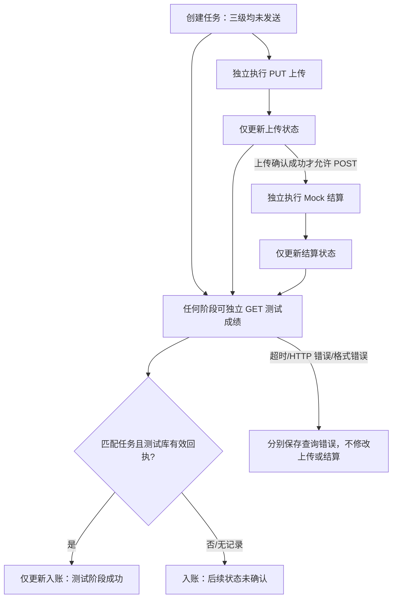

# 三级状态验证（全部为本地 Mock 测试）

三个 `PhaseResult` 独立保存，不以一个 success 布尔值替代全链路状态。每级包含状态、开始/结束时间、HTTP code（可空）、请求字节、单调时钟耗时、截断响应和错误。每次请求先持久化 IN_PROGRESS，再持久化实际结果；`StateEvent` 记录最近 200 次变更。

| 阶段 | 成功证据 | 不足以证明成功的条件 |
| --- | --- | --- |
| 上传 | 本机 PUT 的非 202 2xx + 匹配任务的 testOnly/code=0/completed=true | 创建任务、只发送字节、请求超时、结算状态 |
| 结算 | 本机 POST 的非 202 2xx + 匹配任务的 testOnly/code=0/completed=true | 上传成功、HTTP 200 本身、202 受理、业务 code 非零 |
| 入账 | 独立 GET，响应任务匹配、testOnly=true、code=0、credited=true 且 receiptId 非空，回执来自 SQLite 测试库 | 上传/结算成功、响应没有回执、查无记录、查询超时 |

状态包括：请求未发送、进行中、请求发送失败、超时、服务端拒绝、已受理未完成、业务失败、测试阶段成功、未确认、响应格式错误、进程中断。HTTP 200 业务失败和 HTTP 202 接受都有独立预设；连接中断/超时分别覆盖上传、结算，查询支持超时和服务拒绝。

任务按创建时间保存，可筛选异常任务、查看详情和每级日志，重复查询会追加变更而不推断其他阶段。报告 JSON 顶层 `testOnly=true`，包含任务状态、轨迹测试快照及应用内本地校验日志。最多 20 个任务、25000 个测试轨迹点，清空需确认，并且不会清空运动档案。

JUnit 在真实本机 HTTP socket 上验证上传、结算、查询，而非仅构造「成功」对象；测试使用内存 TestLedger，Android 运行时则使用独立 SQLite 实现。JUnit 通过不等于 SQLite/Android 界面实测；具体执行范围以测试报告为准。任何本地测试成功都不代表真实校园平台成绩入账。
